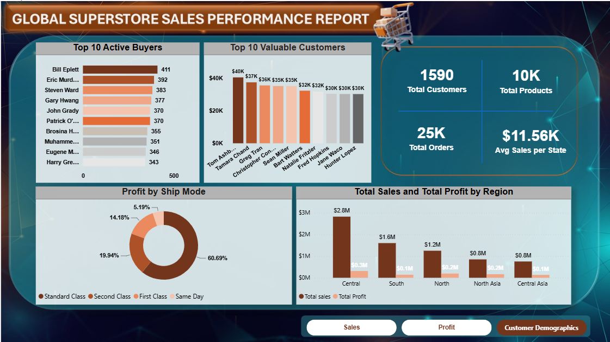

# Global Superstore Sales Performance Analysis

## Project Overview
This project analyzes the Global Superstore dataset to understand sales performance, profitability, product categories, and regional business performance.

The project demonstrates data cleaning, SQL analysis, and dashboard development using Python, MySQL, and Power BI.

## Tools & Technologies
- Excel
- Python (Pandas)
- MySQL Workbench
- Power BI
- DAX
- GitHub

## Project Workflow

### 1. Data Cleaning – Python
Used Python and Pandas to:
- Load the original Excel dataset.
- Check for duplicate records.
- Remove unnecessary whitespace.
- Convert date columns into datetime format.
- Convert numerical columns into appropriate data types.
- Handle missing postal codes.
- Export cleaned data into CSV and Excel files.

**Dataset Size:** 51,290 rows and 24 columns.

### 2. SQL Analysis – MySQL
Practiced SQL concepts using MySQL Workbench:
- SELECT statements
- WHERE conditions
- GROUP BY and ORDER BY
- Aggregate functions
- HAVING conditions
- CASE statements
- Subqueries
- JOIN operations
- Window functions

**Note:** The current SQL table contains 195 records and was used for SQL practice.

### 3. Power BI Dashboard
Created a three-page interactive dashboard:

- Sales Overview
- Profit Analysis
- Regional Analysis

Used DAX measures, KPIs, charts, and interactive navigation to explore business performance.

## Dashboard Screenshots

### Sales Overview

### Profit Analysis

### Regional Analysis

## Project Files

| File | Description |
|---|---|
| global_superstore.xlsx | Original dataset |
| Global-Superstore-Analysis.py | Python cleaning script |
| global_superstore_analysis.sql | SQL queries |
| Global Superstore Sales Analysis Report.pbix | Power BI dashboard |
| PNG files | Dashboard screenshots |

## Key Learning Outcomes
- Data cleaning using Python.
- SQL querying and data exploration.
- KPI calculations using DAX.
- Interactive dashboard development using Power BI.
- Project documentation using GitHub.

## Author

**Sandra Saji**

GitHub: [sandrasaji-data-analyst](https://github.com/sandrasaji-data-analyst)
