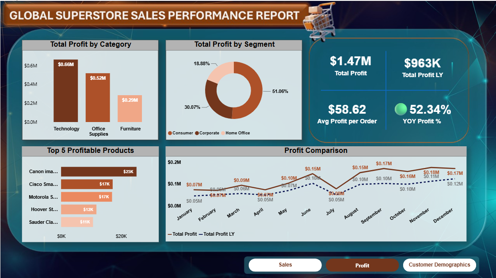

# Global Superstore Sales Performance Analysis

## 1. Project Overview

This project focuses on analyzing the Global Superstore dataset to understand sales performance, profitability, customer behavior, product categories, and regional business performance.

The project follows an end-to-end data analytics workflow using Python, MySQL, and Power BI.

## 2. Tools and Technologies

- Microsoft Excel – Original dataset
- Python – Data cleaning and preprocessing
- Pandas – Data manipulation
- MySQL Workbench – SQL querying and data analysis
- Power BI – Interactive dashboard development
- DAX – KPI and measure calculations
- GitHub – Project documentation and version control

## 3. Project Workflow

### Step 1: Data Cleaning and Preprocessing – Python

Used Python and Pandas to clean and preprocess the original Global Superstore dataset.

**Data Cleaning Steps:**

1. Loaded the original Excel dataset using Pandas.
2. Checked for duplicate records and removed duplicates.
3. Removed unnecessary whitespace from text columns.
4. Converted Order Date and Ship Date into datetime format.
5. Converted Sales, Quantity, Discount, Profit, and Shipping Cost into numeric data types.
6. Checked missing values in the dataset.
7. Handled missing Postal Code values by replacing them with 0.
8. Checked the cleaned dataset information and dimensions.
9. Exported the cleaned dataset into CSV and Excel formats.
10. Verified the final row count.

**Dataset Information:**
- Original Rows: 51,290
- Total Columns: 24
- Duplicate Records: Checked and removed if present.

**Output Files:**
- `global_superstore_cleaned.csv`
- `global_superstore_cleaned.xlsx`

**Library Used:** Pandas

### Step 2: SQL Analysis – MySQL Workbench

Used MySQL Workbench to perform data exploration and analysis.

**SQL Concepts Covered:**

- CREATE DATABASE
- SELECT statements
- DISTINCT
- WHERE conditions
- GROUP BY
- ORDER BY
- Aggregate functions (SUM, COUNT)
- LIMIT
- YEAR() function

**SQL Analysis Performed:**

1. Retrieved records from the dataset.
2. Identified the Top 10 customers based on total sales.
3. Analyzed order counts by product category.
4. Retrieved all distinct countries in the dataset.
5. Filtered orders with sales greater than 500.
6. Analyzed total sales by year.

**Database:** `global_superstore`

**Table:** `global_superstore_cleaned`

**Note:** The current SQL table contains 195 imported records and was used for SQL practice.

### Step 3: Power BI Dashboard Development

Created an interactive three-page Power BI dashboard to analyze business performance using DAX measures and visualizations.

**Dashboard Pages:**

1. Sales Overview
2. Profit Analysis
3. Regional Analysis

**DAX Measures and KPIs Created:**

1. Average Profit per Order
2. Average Sales per Order
3. Average Sales per State
4. Total Average
5. Total Customers
6. Total Orders
7. Total Products
8. Total Profit
9. Total Profit Last Year
10. Total Quantity
11. Total Sales
12. Year-over-Year (YoY) Profit %
13. Year-over-Year (YoY) Sales %

**Power BI Features:**

- KPI cards
- Sales and profit analysis
- Customer and product analysis
- Regional performance analysis
- Year-over-Year growth analysis
- Interactive navigation buttons
- DAX calculations and measures

## 4. Power BI Dashboard Screenshots

### Sales Overview

### Profit Analysis

### Regional Analysis

## 5. Project Files

| File Name | Description |
|---|---|
| `global_superstore.xlsx` | Original Excel dataset |
| `Global-Superstore-Analysis.py` | Python data cleaning script |
| `global_superstore_analysis.sql` | SQL analysis queries |
| `Global Superstore Sales Analysis Report.pbix` | Power BI dashboard |
| `Sales Overview.png` | Sales dashboard screenshot |
| `Profit_Analysis.png` | Profit dashboard screenshot |
| `Regional_Analysis.png` | Regional dashboard screenshot |

## 6. Key Learning Outcomes

- Data cleaning and preprocessing using Python.
- Data manipulation using Pandas.
- SQL querying and data exploration using MySQL.
- Working with aggregate functions and grouping.
- Creating KPIs and measures using DAX.
- Developing interactive dashboards using Power BI.
- Analyzing sales, profit, customers, products, and regional performance.
- Documenting and showcasing analytics projects using GitHub.

## 7. Author

**Sandra Saji**

Aspiring Data Analyst

GitHub: [sandrasaji-data-analyst](https://github.com/sandrasaji-data-analyst)

---

**Project:** Global Superstore Sales Performance Analysis
